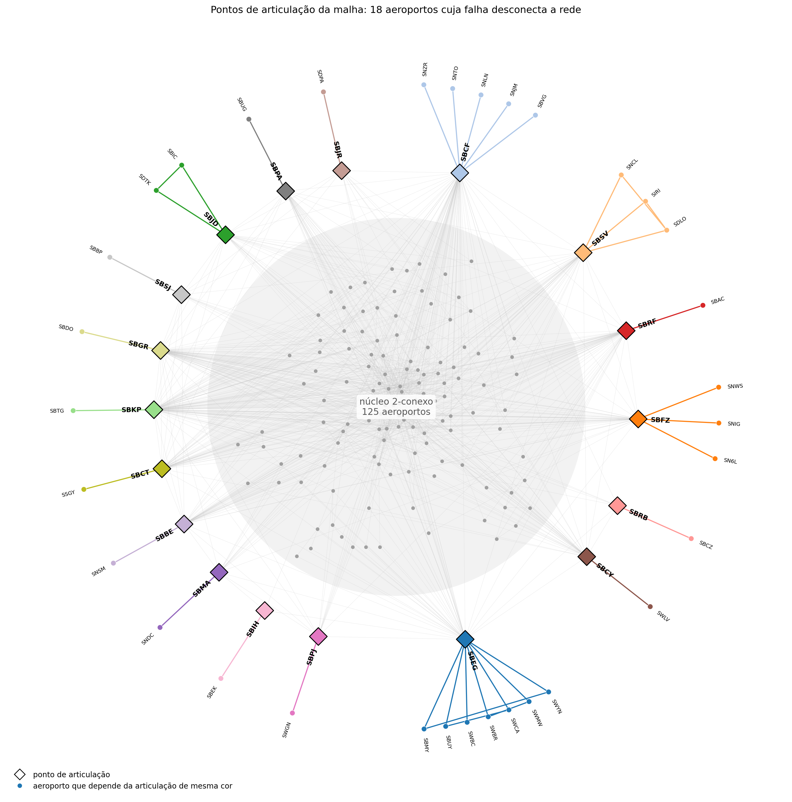
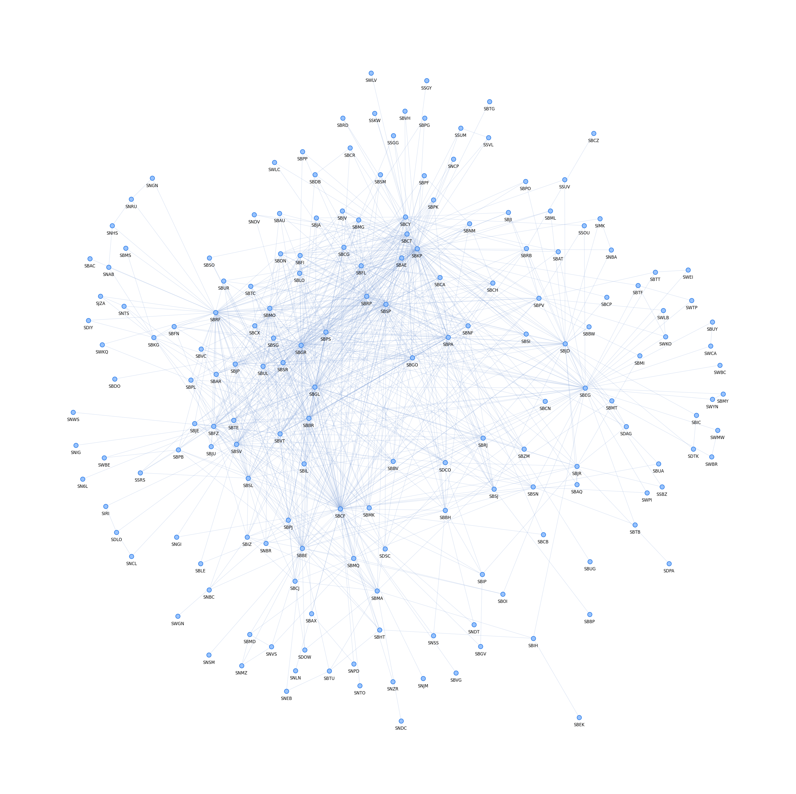

# Robustez da Malha Aérea Doméstica Brasileira
### Conectividade em grafos, Teorema de Menger e fluxo máximo (Edmonds-Karp) aplicados a 787 mil voos de 2025


O projeto une teoria e dados. Na parte teórica, demonstra a equivalência entre *caminhos independentes* e *conjuntos separadores* (Teorema de Menger) e sua ligação com o teorema **Max-Flow Min-Cut**. Na parte aplicada, usa esses resultados para medir, com dados públicos da ANAC, **quão robusta é a malha aérea doméstica brasileira** e **quais aeroportos representam os maiores riscos de desconexão**.

<p align="center">
  
  <br>
  <em>Os 18 pontos de articulação da malha: no centro, o núcleo 2-conexo; no anel, as articulações;
  para fora, os aeroportos que perdem a ligação com a rede se a articulação de mesma cor falhar.</em>
</p>

---

## Sumário

- [Resumo executivo](#resumo-executivo)
- [Principais resultados](#principais-resultados)
- [Fundamentação matemática](#fundamentação-matemática)
- [Dados e modelagem](#dados-e-modelagem)
- [Implementação](#implementação)
- [Como reproduzir](#como-reproduzir)
- [Estrutura do repositório](#estrutura-do-repositório)
- [Limitações e próximos passos](#limitações-e-próximos-passos)
- [Autores e referências](#autores-e-referências)

---

## Resumo executivo

**Problema.** Quais aeroportos, se falharem por clima, obras, greve ou problemas de uma companhia, deixam regiões do país sem ligação aérea com o restante da malha? E qual é a capacidade real de transporte entre os grandes centros?

**Abordagem.** A malha de 2025 foi modelada como um grafo com **176 aeroportos** e **964 rotas**, construído a partir de **1.005.807 registros de voos** do Voo Regular Ativo (VRA) da ANAC. Sobre esse grafo, aplicamos:

| Pergunta de negócio | Ferramenta matemática | Implementação |
|---|---|---|
| Quantos aeroportos precisam falhar para isolar um destino? | Teorema de Menger (versão por vértices) | Fluxo máximo em rede auxiliar, para 14.436 pares |
| Quais aeroportos, sozinhos, desconectam a rede? | Pontos de articulação e blocos 2-conexos | Simulação da falha de cada aeroporto |
| Quanto tráfego a malha comporta entre dois hubs, e por onde ele passa? | Max-Flow Min-Cut e decomposição de fluxo | Edmonds-Karp e decomposição em caminhos por BFS |
| Quais aeroportos são passagem obrigatória entre regiões? | Centralidade de intermediação | `betweenness_centrality` no grafo inteiro |

**Mensagem principal.** *Volume de tráfego, alcance e criticidade estrutural são coisas diferentes.* Guarulhos e Congonhas concentram, cada um, cerca de um quarto das etapas, mas sua falha praticamente não desconecta a malha. Manaus, com apenas 3% das etapas, é o aeroporto cuja falha deixa mais pares de aeroportos sem nenhuma rota. Uma análise de risco baseada só em movimento não identificaria esses pontos.

---

## Principais resultados

### 1. Uma malha com núcleo robusto e periferia frágil

- **Conectividade global:** κ(G) = λ(G) = δ(G) = 1. A desigualdade de Whitney vale com igualdade, e o grafo é formalmente *maximamente conexo* (Hellwig e Volkmann). Como o grau mínimo é 1, porém, essa igualdade só garante que a rede é conexa. Basta uma falha para desconectá-la.
- **Estrutura revelada pela decomposição em blocos:** um **núcleo 2-conexo de 143 aeroportos** (81% da malha), onde nenhuma falha isolada separa dois aeroportos, e uma **periferia de 33 aeroportos**, cada um ligado ao núcleo por um único ponto de articulação.
- **18 pontos de articulação.** Treze deles sustentam um único aeroporto. Os ramos maiores pertencem a **Manaus (7 aeroportos)**, **Confins (5)**, **Fortaleza e Salvador (3 cada)**.

| Aeroporto | Grau | % das etapas | Aeroportos isolados | Pares sem rota |
|---|---:|---:|---:|---:|
| **SBEG** (Manaus) | 47 | 3,0% | 7 | **1.194** |
| **SBCF** (Confins) | 84 | 14,2% | 5 | 860 |
| SBFZ (Fortaleza) | 41 | 4,7% | 3 | 519 |
| SBSV (Salvador) | 41 | 6,8% | 3 | 516 |
| SBGR (Guarulhos) | 68 | 24,7% | 1 | 174 |
| SBSP (Congonhas) | 59 | 23,7% | **0** | **0** |
| SBBR (Brasília) | 48 | 13,9% | 0 | 0 |

### 2. Teorema de Menger: rotas *independentes* entre cada par de aeroportos

Calculamos $p_V(s,t)$, o número máximo de caminhos internamente disjuntos, para **todos os 14.436 pares sem voo direto**.

- **36,1%** dos pares dependem de **um único aeroporto intermediário** ($p_V = 1$).
- **71,1%** dos pares atingem o limite teórico $p_V(s,t) = \min\{d(s), d(t)\}$. Nesses casos, o gargalo é o número de rotas do aeroporto menor, e não o interior da rede.
- No **núcleo** (pares em que os dois aeroportos têm grau ≥ 10), há **de 8 a 27 rotas independentes**, com média de 12,6. Seria preciso a falha simultânea de pelo menos oito aeroportos para interromper essas ligações.
- **Gargalos ocultos:** SDLO tem três rotas, mas todas convergem em Salvador, e por isso $p_V = 1$. O Teorema de Menger torna precisa a diferença entre *número de rotas* e *número de rotas independentes*.

### 3. Fluxo máximo entre os cinco maiores hubs

Com capacidade igual ao número de etapas por rota, calculamos o fluxo máximo (Edmonds-Karp) entre Viracopos, Confins, Guarulhos, Congonhas e Recife, e o decompusemos em caminhos.

- **O gargalo está nas extremidades, não no interior da malha:** os 10 fluxos se reduzem a 4 valores, cada um determinado pelo movimento de um dos hubs. Recife, por exemplo, limita todos os seus pares a 65.827 etapas, o equivalente a 94% do seu próprio movimento.
- **Alta redundância de capacidade:** o fluxo de cada par se distribui por **66 a 306 caminhos**. O voo direto leva no máximo **16,6%** do total.
- **Caminhos de maior fluxo:** Confins → Congonhas (16.328 etapas), Guarulhos → Porto Alegre → Congonhas (12.188) e Guarulhos → Recife (10.933).
- **Brasília como ponte de capacidade:** é a escala mais frequente entre os maiores caminhos (12 de 50), embora sua falha não isole nenhum aeroporto.

### 4. Centralidade: quem é passagem obrigatória

| Ranking por intermediação | Aeroporto | Intermediação | Ranking por grau |
|---:|---|---:|---:|
| 1 | SBKP (Viracopos) | 0,223 | 1 |
| 2 | SBCF (Confins) | 0,198 | 2 |
| 3 | **SBEG (Manaus)** | 0,173 | 8 |
| 4 | SBRF (Recife) | 0,114 | 5 |
| 5 | **SBBE (Belém)** | 0,081 | fora do top 10 |

Nove dos dez aeroportos de maior intermediação são pontos de articulação. A centralidade confirma, por outro caminho, o papel estrutural de Manaus e de Belém na ligação da Região Norte com o restante do país.

### 5. Risco operacional por concentração

O cruzamento com outras colunas do VRA indica um risco que a topologia sozinha não mostra. Em Viracopos, **92,5% das etapas são de uma única empresa**, e outros quatro pontos de articulação passam de 93%. Nesses aeroportos, um problema da companhia dominante teria efeito parecido com a remoção do vértice.

---

## Fundamentação matemática

O relatório ([`relatorio.pdf`](relatorio.pdf)) desenvolve a teoria completa. As demonstrações estão em [`demonstracoes_complementares.pdf`](demonstracoes_complementares.pdf). Em resumo:

**Conectividade.** $\kappa(G)$ e $\lambda(G)$ são o menor número de vértices e de arestas, respectivamente, cuja remoção desconecta $G$. A **desigualdade de Whitney** relaciona os dois ao grau mínimo:

$$\kappa(G) \le \lambda(G) \le \delta(G).$$

**Teorema de Menger.** Para $s, t$ não adjacentes, o número máximo de caminhos internamente disjuntos é igual ao tamanho mínimo de um separador de vértices, e vale o análogo para arestas:

$$p_V(s,t) = k_V(s,t), \qquad p_E(s,t) = k_E(s,t).$$

As versões globais caracterizam a $k$-conexidade em termos de caminhos.

**Ponte com fluxos.** Menger aparece como caso particular do **Max-Flow Min-Cut** (Ford e Fulkerson) por meio de duas redes auxiliares:
- **$N_E$:** cada aresta vira dois arcos de capacidade 1, e o fluxo máximo é igual a $p_E$.
- **$N_V$:** cada vértice $x$ é desdobrado em $x_{\text{in}} \to x_{\text{out}}$, com capacidade 1, e o fluxo máximo é igual a $p_V$.

A integralidade do fluxo e o **lema de decomposição** (todo fluxo inteiro se decompõe em caminhos $s$–$t$) transformam o fluxo máximo num conjunto explícito de caminhos disjuntos. Assim, a prova de Menger se torna **construtiva**.

**Algoritmo de Edmonds-Karp.** É o método de Ford-Fulkerson com caminhos aumentantes mais curtos, encontrados por BFS. Roda em tempo $O(nm^2)$, **independente das capacidades**, o que viabiliza a aplicação a redes reais.

**Medida de criticidade.** Para cada aeroporto $v$, contamos os pares que perdem toda rota em $G - v$:

$$\binom{n-1}{2} - \sum_{i} \binom{|C_i|}{2},$$

em que $C_1, \dots, C_r$ são as componentes conexas de $G - v$.

---

## Dados e modelagem

**Fonte:** [Voo Regular Ativo (VRA)](https://www.gov.br/anac/pt-br/acesso-a-informacao/dados-abertos), dados abertos da Agência Nacional de Aviação Civil. Doze arquivos mensais de 2025.

| Etapa | Registros |
|---|---:|
| Etapas de voo nos arquivos | 1.005.807 |
| Entre aeródromos brasileiros, linha nacional (`N`) | 801.166 |
| Realizadas (viram arestas) | 787.099 |

**Grafo $G$:**
- **Vértices:** aeroportos, identificados pelo código ICAO.
- **Arestas:** pares com ao menos uma etapa realizada no ano, em qualquer sentido. O grafo é simples e não direcionado.
- **Pesos:** cada aresta recebe a capacidade $c(xy)$, igual ao nº de etapas realizadas, usada apenas no cálculo de vazão.
- **Resultado:** $n = 176$, $m = 964$, densidade de 6,3%. Dos 15.400 pares de aeroportos, 14.436 não têm voo direto.

Os voos cancelados não geram arestas, mas entram nas métricas operacionais: taxa de cancelamento, dependência de uma empresa e atraso mediano.

<p align="center">
  
  <br><em>O grafo completo. Uma versão interativa está em <code>grafo_interativo_espacado.html</code>.</em>
</p>

---

## Implementação

O código fica dividido em dois arquivos:
- **[`funcoes_malha.py`](funcoes_malha.py):** módulo com as funções reutilizáveis.
- **[`analise_malha_br.ipynb`](analise_malha_br.ipynb):** notebook que executa o pipeline e produz as tabelas e figuras.

```
CSVs VRA ──► carrega_voos ──► filtra_domesticos ──► monta_grafo ──► G (176 vértices, 964 arestas)
                                     │                                   │
                                     ▼                                   ├──► simula_falhas          (criticidade de cada aeroporto)
                          metricas_operacionais                          ├──► conectividade_pares    (Menger em 14.436 pares)
                          (cancelamento, empresa,                        ├──► vazao_max / rotas_fluxo_max (Edmonds-Karp + decomposição)
                           atraso)                                       └──► centralidades          (grau, proximidade, intermediação)
```

| Função | O que faz |
|---|---|
| `carrega_voos`, `le_csv`, `acha_coluna` | Leitura robusta dos CSVs mensais: identifica as colunas por palavras-chave sem acento e valida o separador e o encoding. |
| `filtra_domesticos` | Filtra as etapas entre aeródromos brasileiros (prefixos ICAO `SB`, `SD`, `SI`, `SJ`, `SN`, `SS`, `SW`) e por tipo de linha. |
| `monta_grafo` | Agrega as etapas por par não ordenado e constrói o grafo ponderado. |
| `metricas_operacionais` | Calcula, por aeroporto, cancelamentos, nº de empresas, participação da empresa dominante e atraso mediano. |
| `simula_falhas` | Remove cada vértice e mede os aeroportos isolados e os pares sem rota. |
| `conectividade_pares` | Calcula $p_V(s,t)$ por fluxo máximo e compara com o limite $\min\{d(s), d(t)\}$. |
| `vazao_max` | Calcula o fluxo máximo com capacidade igual ao nº de etapas (Edmonds-Karp). |
| `rotas_fluxo_max` | Decompõe o fluxo máximo em caminhos $s$–$t$, por BFS e subtração do gargalo. |

**Decisões de engenharia:**
- **Desempenho:** a rede auxiliar $N_V$ e a rede residual são **construídas uma única vez e reaproveitadas** nos 14.436 cálculos de fluxo, o que evita reconstruir estruturas $O(n + m)$ a cada par.
- **Fidelidade à teoria:** usamos explicitamente o algoritmo de Edmonds-Karp (`flow_func=edmonds_karp`), o mesmo estudado na parte teórica, em vez do padrão da biblioteca.
- **Decomposição própria do fluxo:** o NetworkX devolve apenas o fluxo em cada aresta. A função `rotas_fluxo_max` implementa o lema de decomposição para obter os caminhos, priorizando os de menos escalas.
- **Visualização orientada à mensagem:** além do grafo interativo (pyvis/Plotly), criamos um layout radial que separa o núcleo 2-conexo das articulações e dos ramos dependentes, tornando visível a estrutura que as tabelas descrevem.

**Stack:** Python · pandas · NetworkX · NumPy · Matplotlib · pyvis · Plotly · Jupyter

---

## Como reproduzir

```bash
git clone https://github.com/gches7/malha_aerea_nacional.git
cd malha_aerea_nacional
pip install pandas networkx numpy matplotlib pyvis plotly nbformat jupyter
```

1. Os CSVs mensais do VRA de 2025 (`VRA_20251.csv` … `VRA_202512.csv`) já estão na pasta `dados/`.
2. Abra e execute `analise_malha_br.ipynb`. Os parâmetros da primeira célula controlam:
   - **`PASTA`:** a pasta dos dados;
   - **`TIPOS`:** os tipos de linha, por exemplo `["N", "C"]` para incluir os cargueiros;
   - **`HUBS`:** a restrição da análise de pares aos maiores hubs.

As funções também podem ser usadas fora do notebook:

```python
from funcoes_malha import *

dom = filtra_domesticos(carrega_voos("dados"), ["N"])
G = monta_grafo(dom[dom["situacao"] == "REALIZADO"])

criticidade = simula_falhas(G)          # ranking de aeroportos críticos
valor, rotas = rotas_fluxo_max(G, "SBGR", "SBRF")
```

---

## Estrutura do repositório

```
malha_aerea_nacional/
├── dados/                              # CSVs mensais do VRA de 2025 (ANAC)
├── funcoes_malha.py                    # módulo com leitura, modelagem e análises
├── analise_malha_br.ipynb              # notebook com o pipeline completo
├── relatorio.pdf                       # relatório: teoria, aplicação e conclusões
├── demonstracoes_complementares.pdf    # demonstrações dos teoremas
├── grafo_interativo.html               # grafo interativo (pyvis)
├── grafo_interativo_espacado.html      # versão com o núcleo espaçado
├── grafo_interativo_espacado.png       # figura do grafo
├── pontos_articulacao.png              # pontos de articulação e efeito da falha
└── pontos_articulacao_radial.png       # layout radial: núcleo, articulações e ramos
```

---

## Limitações e próximos passos

**Limitações**
- **Agregação anual:** o grafo agrega o ano inteiro, então uma rota com uma única etapa conta como aresta.
- **O que a conectividade ignora:** frequência, horários e sentido dos voos.
- **Capacidade:** é medida em etapas, e não em assentos ou demanda. Como soma os dois sentidos, as vazões calculadas são limites superiores.
- **Caminhos do fluxo:** representam capacidade encadeável, e não itinerários reais de passageiros, que o VRA não registra. A decomposição também não é única.
- **Falhas:** são simuladas uma de cada vez, sem considerar falhas correlacionadas.

**Próximos passos**
- **Usar a base completa do VRA.** Hoje a análise se restringe às etapas domésticas de linha nacional. O próximo passo é incluir os voos internacionais e os demais tipos de linha (cargueiros, por exemplo), para medir como as conexões com o exterior alteram a robustez da malha e o papel dos hubs. O pipeline já está preparado para isso: o filtro por tipo de linha é um parâmetro (`TIPOS`).
- **Calcular as rotas de menor fluxo entre dois aeroportos dados.** Hoje a análise destaca os caminhos de maior fluxo. A ideia é complementá-la com os caminhos menos movimentados entre um par escolhido, identificando ligações subutilizadas, que são candidatas a oportunidades de expansão de oferta ou a pontos frágeis da malha.

---

## Autores e referências

**Autores:** Daniel Moreira Grisolia · Gabriel Ché Silva · Henrique Gonzaga Apratto Gonçalves · Pedro Henrique de Oliveira Viana

**Referências**
- K. Menger. Zur allgemeinen Kurventheorie. *Fundamenta Mathematicae*, 10:96–115, 1927.
- L. R. Ford e D. R. Fulkerson. Maximal flow through a network. *Canadian Journal of Mathematics*, 8:399–404, 1956.
- J. Edmonds e R. M. Karp. Theoretical improvements in algorithmic efficiency for network flow problems. *Journal of the ACM*, 19(2):248–264, 1972.
- A. Hellwig e L. Volkmann. Maximally edge-connected and vertex-connected graphs and digraphs: A survey. *Discrete Mathematics*, 308(15):3265–3296, 2008.
- R. J. Wilson. *Introduction to Graph Theory*. 5ª ed. Pearson, 2010.
- ANAC. Voo Regular Ativo (VRA). Dados abertos, 2025.
